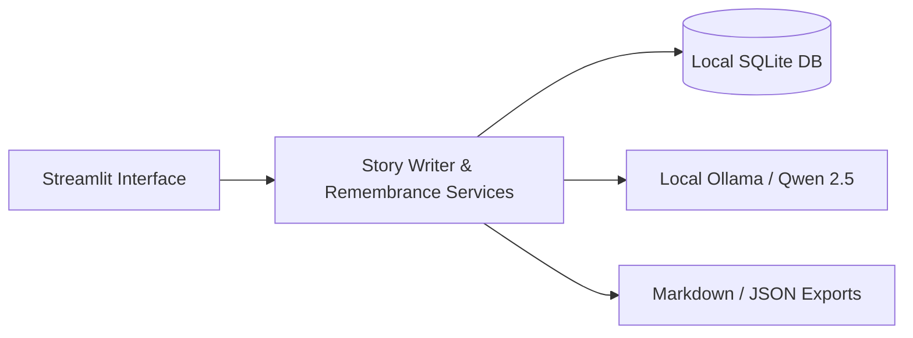

# Ghost in the Machine: Every Memory Deserves to Live On

Every family has stories that gradually fade: the secret pinch of spice in a grandmother's holiday stew, the quiet advice spoken on a front porch during a summer thunderstorm, or the laughter of an uncle whose voice nobody recorded. 

As time marches on, these delicate threads of family history are easily forgotten. Yet when people turn to modern digital tools to write their family memories, they are immediately confronted with uncomfortable realities: privacy policies that grant third-party AI companies license to train on personal narratives, cloud servers where sensitive grief and family lore reside on someone else's hardware, and corporate tools that promise eerie digital necromancy or conversational avatars of the deceased.

For **Hacktoberfest 2026 DEV Open-Source AI Challenge (Week 4: “Ghost in the Machine”)**, we built **Echoes AI** — a private, respectful, local-first digital memory journal with the tagline:

> *“Every memory deserves to live on.”*

---

## What is Echoes AI?

**Echoes AI** is an open-source personal memory journal that helps people preserve personal stories, meaningful moments, family traditions, and tributes for loved ones.

It allows you to jot down rough notes or memory fragments and uses local, open-weight AI to:
1. **Enhance rough notes** into vivid, well-structured stories across three distinct narrative voices (*Warm & Heartfelt*, *Simple & Conversational*, *Nostalgic & Reflective*).
2. **Generate gentle oral-history interview questions** that guide you to recall small sensory details, traditions, and conversations.
3. **Organize and search memories** in an offline SQLite library with tags and categories.
4. **Draft dignified Remembrance Pages** honoring loved ones without intrusive questions or fabricated history.
5. **Export & Backup** everything to Markdown, TXT, or validated JSON archives.

---

## Why Local-First AI Matters for Memory Preservation

Personal memories are among the most sensitive data a human can record. They involve living family members, intimate childhood vulnerabilities, and the tender grief of lost loved ones.

Transmitting these stories to commercial LLM APIs introduces real risks:
- Memory data could be logged, analyzed, or incorporated into training datasets.
- Centralized cloud breaches expose intimate family history.
- Cloud API price changes or service deprecations can lock families out of their own legacy.

By running open-weight models (such as **Qwen 2.5** or **Llama 3.2**) locally via **Ollama**, Echoes AI delivers complete data sovereignty:
- **Zero Cloud Transmission**: Your stories never cross the network.
- **Offline Reliability**: Core journaling, search, exports, and offline tribute templates function completely without internet access.
- **Permanent Ownership**: The SQLite database and Markdown exports stay on your hard drive forever.

---

## Ethical Boundaries: The Anti-Necromancy Principle

In keeping with the Hacktoberfest Week 4 theme, we gave deep thought to the "Ghost in the Machine." While modern generative AI can mimic speech patterns, we believe it is unethical and psychologically harmful to claim that AI can communicate with deceased people or recreate human souls.

Echoes AI implements strict ethical guardrails:
1. **No Consciousness Emulation**: Echoes AI will never simulate interactive conversations with deceased relatives.
2. **Factual Grounding**: The local model is instructed to preserve supplied names, dates, and authentic details without inventing deceased relatives or false tragedies.
3. **Clear Distinction**: The user interface always displays the raw, unedited notes side-by-side with the AI-enhanced wording.
4. **Transparent Storage**: We explicitly inform users that their SQLite database is unencrypted on disk so they understand their machine's threat model.

---

## The Workflow in Action

1. **Jot the Rough Fragment**: In the *Memory Editor*, write whatever you remember:
   > *"Grandma Clara made lemonade on hot August afternoons. Yellow ceramic pitcher with chips on the handle. Cane sugar, mint from garden."*
2. **Interview Assistant**: Click *Generate Interview Questions*. The local model gently prompts:
   > *"What did the wooden porch feel like in the afternoon heat?"*
   > *"Was there a specific phrase Grandma Clara said while stirring?"*
3. **Narrative Enhancement**: Select your desired voice (e.g. *Warm & Heartfelt*) and let the model weave the notes into a narrative.
4. **Review & Edit**: You retain complete editorial control to tweak or correct anything before saving.
5. **Remembrance Sanctuary**: Build a timeless memorial page compiling their favorite sayings, cherished customs, and life stories into clean Markdown.

---

## Technical Stack & Architecture

- **Interface**: Streamlit with custom CSS (warm cream `#FAF7F2`, muted burgundy `#6B1D2F`, and subtle marigold `#D9822B`).
- **Local AI Inference**: Ollama running open-weight `qwen2.5:3b` (Apache 2.0 license).
- **Storage**: Python's native SQLite with parameterized queries and thread-safe connection pooling.
- **Testing**: 20 automated pytest unit and integration tests covering repository CRUD, JSON backup integrity, duplicate detection, and Ollama offline fallbacks.



---

## Try Echoes AI

The project is fully open source under the MIT License on GitHub:
👉 **[github.com/your-username/echoes-ai](https://github.com/your-username/echoes-ai)**

### Quick Start
```bash
# 1. Clone & install
git clone https://github.com/your-username/echoes-ai.git
cd echoes-ai
pip install -r requirements.txt

# 2. Run local model
ollama pull qwen2.5:3b
ollama serve

# 3. Launch
streamlit run app.py
```

*Every memory deserves to live on. Keep yours safe, gentle, and strictly your own.*
